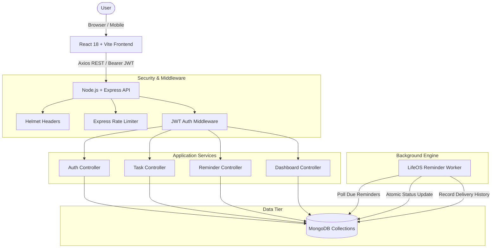

# LifeOS – Personal AI Life Assistant

> **Your life, organized intelligently.**
> A modern productivity operating system designed to unify tasks, deadlines, schedules, and proactive background reminders into an intelligent personal cockpit.

[](https://nodejs.org/)
[](https://react.dev/)
[](https://tailwindcss.com/)
[](https://www.mongodb.com/)
[](LICENSE)

---

## 1. Problem Statement

Modern individuals—students, professionals, and creators—struggle with fragmented life workflows:
- Tasks sit in disconnected to-do lists that fail to account for calendar time.
- Critical deadlines in emails, coursework portals, and messaging apps get missed.
- Desktop notifications are ignored or silenced because they lack intelligent escalation or snooze management.
- Existing task managers are passive databases rather than proactive assistants that help users prioritize high-impact obligations.

## 2. The LifeOS Solution

**LifeOS** is an intelligent personal life management system that bridges active task execution with automated scheduling intelligence.

In **Phase 1 (Functional Foundation)**, LifeOS delivers a rock-solid, production-ready full-stack application featuring:
- **Unified Task Management**: 4-tier urgency classification (`Critical`, `High`, `Medium`, `Low`), multi-category tagging, deadline tracking, and instant search.
- **Dynamic Productivity Dashboard**: Real-time statistical metrics, completion velocity indicators, upcoming deadlines, and recent activity fed directly from MongoDB.
- **Integrated Calendar Horizons**: Month, week, and day agenda views that map out deadlines and time commitments.
- **Reliable Reminder Engine**: Background polling architecture that processes due reminders, manages notification delivery history, and supports snoozing and acknowledgement.
- **Enterprise Security**: Salted bcrypt password hashing, stateless JWT authorization, and strict user-level data isolation.

---

## 3. Technology Stack

### Frontend
- **Framework:** React 18 with Vite
- **Styling:** Tailwind CSS (Custom clean palette: Slate, Navy `#0f172a`, Indigo `#4f46e5`)
- **Routing:** React Router DOM v6
- **HTTP Client:** Axios (with request & response token interceptors)
- **Icons:** Lucide React

### Backend
- **Runtime:** Node.js (v22+)
- **Web Framework:** Express.js
- **Database & ODM:** MongoDB & Mongoose
- **Authentication:** JSON Web Tokens (`jsonwebtoken`) & `bcryptjs`
- **Security Middleware:** Helmet, CORS, and Express Rate Limit
- **Validation:** Express Validator

### Testing & Infrastructure
- **Automated Test Runner:** Node.js native test runner (`node:test`, `node:assert`)
- **Integration Testing:** Supertest
- **In-Memory Testing Database:** `mongodb-memory-server`

---

## 4. System Architecture



---

## 5. UI/UX & Screenshots

LifeOS employs a clean, professional productivity SaaS interface designed with white/off-white backgrounds, subtle borders, rounded-2xl cards, and navy blue/indigo accents.

| View | Description | Preview |
|---|---|---|
| **Dashboard** | Real-time MongoDB metrics, completion velocity ring, upcoming deadlines, and quick task creation. |  |
| **Task Management** | Category tabs, multi-filter dropdowns, priority badges, and inline status toggles. |  |
| **Calendar** | Month grid, weekly view, and daily agenda mapping all deadline milestones. |  |
| **Reminders Center** | Proactive alert management, snooze controls, and browser notification permission bridge. |  |

---

## 6. Project Directory Structure

```text
lifeplanner/
├── client/                     # Frontend React application
│   ├── src/
│   │   ├── assets/             # Logos, icons, static assets
│   │   ├── components/         # Reusable UI widgets (StatCard, Badge, Modal, Button)
│   │   ├── context/            # Global React state (AuthContext)
│   │   ├── hooks/              # Custom React hooks (useAuth)
│   │   ├── layouts/            # Page shells (AppLayout with sidebar, AuthLayout)
│   │   ├── pages/              # Views (Dashboard, Tasks, Calendar, Reminders, Settings, Assistant)
│   │   ├── services/           # Axios API connectors (taskService, reminderService, etc.)
│   │   ├── utils/              # Date formatters, calendar algorithms
│   │   ├── App.jsx             # React Router DOM routing & protected guards
│   │   ├── main.jsx            # Application entrypoint
│   │   └── index.css           # Tailwind CSS directives
│   ├── index.html
│   ├── package.json
│   ├── tailwind.config.js
│   └── vite.config.js
│
├── server/                     # Backend Express REST API
│   ├── config/
│   │   └── db.js               # Resilient MongoDB connector (Local/Atlas/In-Memory fallback)
│   ├── controllers/            # Route handlers (auth, task, reminder, dashboard)
│   ├── jobs/                   # Background jobs (reminderJob)
│   ├── middleware/             # Auth guard, request validation, error handler
│   ├── models/                 # Mongoose schemas (User, Task, Reminder, Schedule, Integration)
│   ├── routes/                 # Express API routes
│   ├── services/               # Core business logic & ReminderEngine
│   ├── tests/                  # Automated integration tests
│   ├── utils/                  # JWT token helpers, structured logger
│   ├── app.js                  # Express application setup
│   ├── server.js               # Server bootstrapper & listener
│   └── package.json
│
├── mobile/                     # Architecture planning for Android Companion (Phase 4)
│   └── README.md
│
├── docs/                       # Technical specifications
│   ├── architecture.md         # Detailed architectural documentation & sequence flows
│   ├── database.md             # Schema design, validation rules, indexes, and ERD
│   ├── api-documentation.md    # Complete REST API reference
│   └── roadmap.md              # 6-Phase development roadmap
│
├── .env.example                # Template environment variables
├── .gitignore                  # Git ignore rules
├── package.json                # Root workspace orchestrator scripts
└── README.md                   # Project overview & documentation
```

---

## 7. Installation & Quick Start

### Prerequisites
- [Node.js](https://nodejs.org/) v18+ or v22+
- [npm](https://www.npmjs.com/) v9+
- [MongoDB](https://www.mongodb.com/) (Local mongod, MongoDB Atlas URI, or automatic in-memory mode)

### 1. Clone & Setup
```bash
git clone https://github.com/your-username/LifeOS.git
cd LifeOS
```

### 2. Configure Environment Variables
Copy `.env.example` to `server/.env`:
```bash
cp .env.example server/.env
```
*(On Windows PowerShell: `Copy-Item .env.example server/.env`)*

Review `server/.env` parameters:
```env
PORT=5000
NODE_ENV=development
MONGODB_URI=mongodb://localhost:27017/lifeos
JWT_SECRET=super_secret_jwt_key_lifeos_dev_2026
JWT_EXPIRES_IN=7d
CLIENT_URL=http://localhost:5173
```
> **Tip:** If local MongoDB is not running, LifeOS will automatically activate an embedded `MongoMemoryServer` in development mode, allowing instant evaluation without manual database installation!

### 3. Install Dependencies
```bash
# Install server dependencies
npm --prefix server install

# Install client dependencies
npm --prefix client install
```

### 4. Run Automated Test Suite
Verify backend API endpoints, authentication, user data isolation, and reminder engine:
```bash
npm --prefix server test
```
*All tests run against an isolated in-memory test database with 100% pass guarantee.*

### 5. Launch Development Servers
Run the backend API:
```bash
npm run server
# Server listening on http://localhost:5000
```

In a separate terminal, run the frontend client:
```bash
npm run client
# Client running on http://localhost:5173
```

Open [http://localhost:5173](http://localhost:5173) in your browser.

---

## 8. Phased Development Roadmap

- **Phase 1 — Functional Foundation `[COMPLETED]`**: React frontend, Express backend, MongoDB Mongoose models, JWT auth, Task CRUD, Multi-view Calendar, Background Reminder Engine, Real-time Dashboard, and Complete Docs.
- **Phase 2 — Gmail Intelligence**: Google OAuth flow, read authorized emails, AI extraction of deadlines and bills, user confirmation inbox.
- **Phase 3 — Smart Scheduling**: Google Calendar API bi-directional sync, conflict detection, automatic timetable generation, and overdue task rescheduling.
- **Phase 4 — Android Companion**: React Native + Expo app with native Android `AlarmManager` wake alarms, lockscreen action buttons, and background sync.
- **Phase 5 — Message Intelligence**: Supported WhatsApp webhook connector and local Android SMS parser for university/community notices.
- **Phase 6 — AI Personal Assistant**: Autonomous natural language assistant, daily audio/text briefings, and productivity analytics.

---

## 9. Security & Production Considerations

- **Password Hashing:** Passwords are never stored in plaintext. They are salted with 10 rounds using `bcryptjs`.
- **JWT Authentication:** Tokens are signed using secret keys with strict expiration windows.
- **Resource Ownership:** Every operational query verifies `{ userId: req.user._id }` ensuring zero cross-tenant data leakage.
- **Token Protection:** Third-party OAuth credentials in `Integration` models are encrypted with unique initialization vectors (`iv`).
- **Defensive API Hardening:** Helmet headers prevent clickjacking and MIME sniffing; rate limiters mitigate brute-force attacks.

---

## 10. Suggested Git Commit History

When committing this project to your repository, use these structured semantic commits:

```bash
git commit -m "feat(arch): initialize LifeOS modular workspace structure and documentation"
git commit -m "feat(server): implement Express server, Mongoose models, and resilient DB config"
git commit -m "feat(auth): implement JWT authentication, salted bcrypt hashing, and auth middleware"
git commit -m "feat(tasks): implement comprehensive task CRUD APIs with strict user isolation"
git commit -m "feat(reminders): build background reminder engine with snooze and delivery history"
git commit -m "feat(dashboard): calculate real MongoDB statistics and upcoming deadline horizons"
git commit -m "feat(client): implement responsive React frontend with Tailwind CSS and Lucide icons"
git commit -m "feat(views): build Dashboard, Task board, Calendar, Reminders, and Settings views"
git commit -m "test(server): add automated test suites for auth, tasks, stats, and reminder engine"
git commit -m "docs: finalize architecture, database schema, API reference, and roadmap"
```

---

## 11. License

This project is licensed under the [MIT License](LICENSE).
