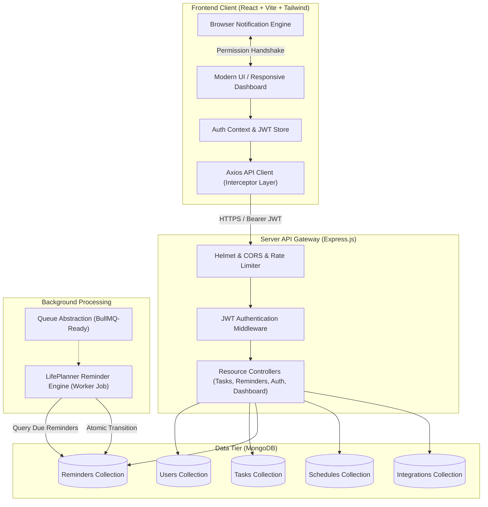
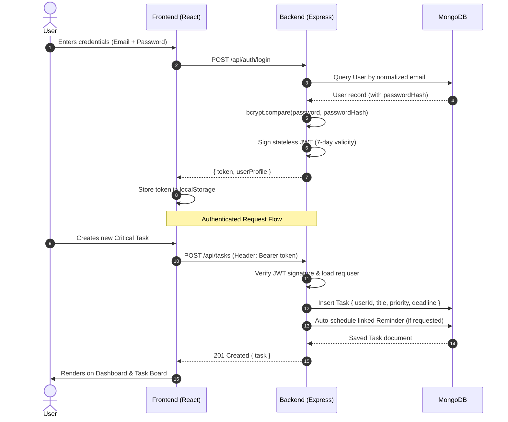

# LifePlanner System Architecture

LifePlanner is engineered as a secure, high-performance personal life assistant designed to consolidate tasks, deadlines, scheduled commitments, and proactive reminders into an integrated system.

---

## 1. High-Level Architectural Diagram



---

## 2. Component Breakdown

### A. Frontend Layer (`client/`)
- **React 18 & Vite**: Fast bundling, sub-second HMR, and optimized production chunking.
- **Tailwind CSS**: Custom palette featuring slate and navy backgrounds with indigo accents, rounded-2xl cards, and subtle border shadows.
- **Axios Interceptor**: Handles JWT token injection on outgoing requests and automatically handles `401 Unauthorized` token expiration events by broadcasting to `AuthContext`.
- **Browser Notification Bridge**: Graceful permission request and delivery handling with explicit limitations disclosure (browser must remain active; not an audio device wake alarm).

### B. Backend Layer (`server/`)
- **Express.js API Router**: Clean RESTful endpoints segregated by domain (`/api/auth`, `/api/tasks`, `/api/reminders`, `/api/dashboard`).
- **Security & Hardening**:
  - `Helmet`: Sets HTTP security headers (CSP, HSTS, X-Content-Type-Options).
  - `cors`: Strict origin validation against configured `CLIENT_URL`.
  - `express-rate-limit`: Prevents brute-force credential stuffing and DoS attacks.
  - `express-validator`: Input sanitization and payload schema validation.

### C. Background Processing Tier (`server/services/reminderEngine.js`)
- **Persistent Timestamp Processing**: Reminders are stored in MongoDB with exact UTC timestamps.
- **Atomic Concurrency Control**: Uses MongoDB's atomic `findOneAndUpdate` queries targeting `{ status: 'scheduled', remindAt: { $lte: new Date() } }` to ensure zero duplicate alerts across concurrent ticks.
- **Delivery Auditing**: Every triggered reminder appends to its `deliveryHistory` subdocument array with timestamp, channel, and execution details.
- **BullMQ / Redis Preparedness**: The engine operates through a decoupled worker interface designed to seamlessly route through Redis/BullMQ queues upon mobile rollout in Phase 4.

---

## 3. Data Flow & Security Principles



### Data Isolation
All queries strictly enforce user-level scoping:
```javascript
const query = { userId: req.user._id };
```
No task, reminder, or schedule document can be queried, modified, or deleted without passing ownership checks against `req.user._id`.
