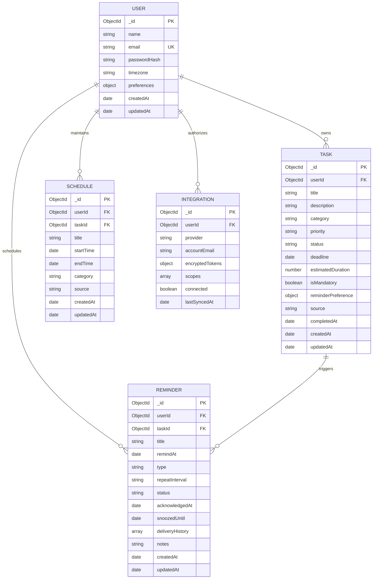

# LifeOS Database Design & Schema Specification

LifeOS uses **MongoDB** with **Mongoose ODM** to maintain a flexible, document-based data architecture with strict validation and user data isolation.

---

## 1. Entity-Relationship Diagram (ERD)

---

## 2. Models Specification

### 2.1 User Model (`User.js`)
Stores authenticated user credentials and global application settings.

| Field | Type | Validation / Constraints | Description |
|---|---|---|---|
| `_id` | ObjectId | Primary Key | Generated by MongoDB |
| `name` | String | Required, Trim, Max: 100 | Full name of the user |
| `email` | String | Required, Unique, Lowercase, Trim, Regex | Validated RFC email address |
| `passwordHash` | String | Required, Min: 6 | Salted bcrypt hash (`bcrypt.genSalt(10)`) |
| `timezone` | String | Default: `'UTC'` | User's preferred timezone |
| `preferences.theme` | String | Enum: `['light', 'dark', 'system']` | UI theme mode |
| `preferences.notifications` | Object | `{ browser: Boolean, email: Boolean, leadTimeMinutes: Number }` | Delivery preferences |
| `createdAt` | Date | Timestamp | Automatic ISO Date |
| `updatedAt` | Date | Timestamp | Automatic ISO Date |

**Methods:**
- `matchPassword(candidate)`: Compares candidate plaintext password against `passwordHash`.
- `toJSON()`: Strips `passwordHash` before returning payload to API clients.

---

### 2.2 Task Model (`Task.js`)
Core operational entity for commitments, homework, work milestones, and chores.

| Field | Type | Validation / Constraints | Description |
|---|---|---|---|
| `userId` | ObjectId | Ref: `User`, Required, Indexed | Parent user ID |
| `title` | String | Required, Trim, Max: 200 | Task title |
| `description` | String | Trim, Max: 2000 | Additional context or checklist |
| `category` | String | Enum: `['College', 'Work', 'Personal', 'Finance', 'Health', 'Other']` | Categorization tag |
| `priority` | String | Enum: `['Critical', 'High', 'Medium', 'Low']` | Priority tier |
| `status` | String | Enum: `['Pending', 'In Progress', 'Completed', 'Cancelled']` | Current progress status |
| `deadline` | Date | Indexed, Default: `null` | Target completion deadline |
| `estimatedDuration` | Number | Min: 1, Default: 30 | Expected time required in minutes |
| `isMandatory` | Boolean | Default: `false` | Marks non-negotiable obligations |
| `reminderPreference` | Object | `{ enabled: Boolean, remindBeforeMinutes: Number, type: String }` | Pre-deadline alert preference |
| `source` | String | Enum: `['manual', 'gmail', 'whatsapp', 'calendar', 'ai']` | Provenance of task item |
| `completedAt` | Date | Default: `null` | Timestamp when marked completed |

**Indexes:**
- `{ userId: 1, status: 1 }`
- `{ userId: 1, deadline: 1 }`
- `{ userId: 1, category: 1 }`
- `{ userId: 1, priority: 1 }`

---

### 2.3 Reminder Model (`Reminder.js`)
Time-triggered alert entity queried by the background Reminder Engine.

| Field | Type | Validation / Constraints | Description |
|---|---|---|---|
| `userId` | ObjectId | Ref: `User`, Required, Indexed | Target user ID |
| `taskId` | ObjectId | Ref: `Task`, Default: `null` | Associated task if applicable |
| `title` | String | Required, Trim, Max: 200 | Reminder message |
| `remindAt` | Date | Required, Indexed | Timestamp when alert must fire |
| `type` | String | Enum: `['browser', 'email', 'system']` | Notification delivery protocol |
| `repeatInterval` | String | Enum: `['none', 'daily', 'weekly', 'custom']` | Recurrence pattern |
| `status` | String | Enum: `['scheduled', 'triggered', 'acknowledged', 'snoozed', 'cancelled']` | Operational status |
| `acknowledgedAt` | Date | Default: `null` | Time user acknowledged alert |
| `snoozedUntil` | Date | Default: `null` | Rescheduled target time |
| `deliveryHistory` | Array | `[{ deliveredAt, channel, status, details }]` | Complete dispatch audit log |
| `notes` | String | Max: 1000 | Optional contextual details |

**Indexes:**
- `{ status: 1, remindAt: 1 }`: Optimized for high-frequency engine queries.
- `{ userId: 1, remindAt: 1 }`: Optimized for client list sorting.

---

### 2.4 Schedule & Integration Models
- **Schedule**: Captures discrete calendar time blocks (`startTime`, `endTime`, `category`, `source`).
- **Integration**: Securely records third-party OAuth connections (`provider`, `encryptedTokens: { accessToken, refreshToken, iv }`, `scopes`, `connected`). Tokens are stored encrypted with initialization vectors to prevent leakage.
